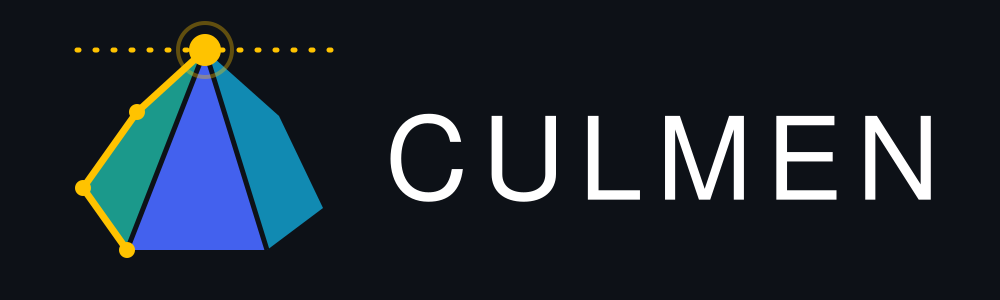

<p align="center">
  
</p>

**Linear, mixed-integer and convex quadratic programming in Rust.** Write a model the way the mathematics reads,
build it into a checked LP, and solve it on a switchable backend. You can watch the search live and stop it
cooperatively at any moment.

[](#licence)
[](https://www.rust-lang.org)
[](https://doc.rust-lang.org/edition-guide/)
[](https://highs.dev)

```rust
use culmen::prelude::*;

fn main() -> Result<(), Box<dyn std::error::Error>> {
    // A knapsack: take the items of most value that fit in the capacity.
    let value = [10.0, 13.0, 7.0, 8.0];
    let weight = [5.0, 6.0, 4.0, 3.0];

    let mut m = Model::new();
    let take = m.add_vars(4, |i| Var::binary().name(format!("take[{i}]")));
    m.add_constraint(LinExpr::sum((0..4).map(|i| weight[i] * take[i])).leq(10.0));
    m.maximize(LinExpr::sum((0..4).map(|i| value[i] * take[i])));

    let mut solver = Solver::new(Highs::new(), m.build()?)?;
    let Outcome::Optimal(best) = solver.solve(Request::new())?.outcome else {
        return Err("no optimum".into());
    };
    assert_eq!(best.objective, 21.0);
    println!("taken: {:?}", (0..4).filter(|&i| best.values[take[i]] > 0.5).collect::<Vec<_>>());
    Ok(())
}
```

## Why culmen

- **The LP is checked data.** A model builds an `Lp` with typed `Col` and `Row` handles. Every number is checked
  once, when the model is built, and an error names the variable or constraint at fault. The handles a model
  returns read the solution directly: `best.values[x]`.
- **Literals are checked at compile time.** `bounds!(0.0, 40.0)`, `relative_gap!(0.01)` and `threads!(4)` are
  checked when the code compiles, so an invalid literal is a compile error, not a panic at run time.
- **Two equal ways to write a model.** You can write plain methods and operators (`2.0 * x + y`,
  `expr.leq(10.0)`, `LinExpr::sum`, `Model::add_var_map`), or use the `variable!`, `constraint!`, `objective!` and
  `sum!` macros, which expand to exactly those calls.
- **Convex quadratic objectives, checked.** `x * y`, `x * x` and `(x - 1) * (x - 1)` build quadratic objectives
  beside linear constraints, and building checks the objective is convex to minimize or concave to maximize, with a
  stated tolerance. A quadratic constraint does not compile.
- **Model classes are typed.** Every LP knows its class (`Lp`, `Milp`, `Qp`, `Miqp`), every backend declares the
  classes it solves, and `Solver::new` refuses any other with a typed error naming both, before the solver sees it.
- **Any solver behind one seam.** `Backend` is an open trait with typed, solver-neutral callback events: log,
  progress, interrupt poll, feasible and improving solutions, lazy constraints, user cuts, heuristic solutions,
  and native events for what only one solver offers. HiGHS is the first backend, and every HiGHS callback is
  mapped.
- **A solve you can watch and stop.** A `Stop` can be an `AtomicBool`, a closure or a cancellation token. An
  `Observer` receives throttled progress, every new incumbent and each complete log line, while the solver's own
  console output stays quiet. A panic in an observer or callback stops the solve and unwinds out of `solve`; it
  never aborts the process.
- **`unsafe` lives in one crate.** `culmen_core` forbids it. `culmen_highs` is the only crate with `unsafe`, and
  every block there has a `// SAFETY:` comment.

## Keyed families and the macros

Families of variables and constraints are keyed by your own domain keys. This is a generalized assignment
problem: put each product in exactly one location, stay within each location's capacity, and walk the least.

```rust
use culmen::prelude::*;

fn main() -> Result<(), Box<dyn std::error::Error>> {
    let (products, locations) = (0..4, 0..2);
    let volume = [4.0, 3.0, 5.0, 2.0];
    let capacity = [8.0, 7.0];
    let walk = [[1.0, 3.0], [2.0, 1.0], [4.0, 2.0], [1.0, 1.0]];

    let mut m = Model::new();
    let x = m.add_var_map(product(&products, &locations), |(p, l)| Var::binary().name(format!("x[{p},{l}]")));
    m.add_constraint_map(products.clone(), |&p| {
        (format!("once[{p}]"), LinExpr::sum(locations.clone().map(|l| x[(p, l)])).equals(1))
    });
    m.add_constraint_map(locations.clone(), |&l| {
        (format!("cap[{l}]"), LinExpr::sum(products.clone().map(|p| volume[p] * x[(p, l)])).leq(capacity[l]))
    });
    m.minimize(LinExpr::sum(x.iter().map(|(&(p, l), x)| walk[p][l] * x)));

    let mut solver = Solver::new(Highs::new(), m.build()?)?;
    if let Some(best) = solver.solve(Request::new())?.outcome.solution() {
        for (&(p, l), value) in x.values(&best.values) {
            if value > 0.5 {
                println!("product {p} -> location {l}");
            }
        }
    }
    Ok(())
}
```

With the `macros` feature, the same model reads like its formulation. Index sets can be filtered, as in
`x[p in products, l in locations if fits(p, l)]`, and `x[p, l]` reads the family entry keyed `(p, l)`:

```rust
use culmen::prelude::*;

fn main() -> Result<(), Box<dyn std::error::Error>> {
    let (products, locations) = (0..4, 0..2);
    let volume = [4.0, 3.0, 5.0, 2.0];
    let capacity = [8.0, 7.0];
    let walk = [[1.0, 3.0], [2.0, 1.0], [4.0, 2.0], [1.0, 1.0]];

    let mut m = Model::new();
    variable!(m, x[p in products, l in locations], Bin);
    constraint!(m, once[p in products], sum!(x[p, l] for l in locations) == 1);
    constraint!(m, cap[l in locations], sum!(volume[p] * x[p, l] for p in products) <= capacity[l]);
    objective!(m, Min, sum!(walk[p][l] * x[p, l] for p in products, l in locations));

    let lp = m.build()?;
    assert_eq!((lp.num_cols(), lp.num_rows()), (8, 6));
    Ok(())
}
```

## A convex quadratic program

A quadratic objective is written with the same operators. The point of the half-plane `x + y <= 1` nearest
`(1, 2)` is `(0, 1)`, at squared distance 2:

```rust
use culmen::prelude::*;
use culmen::ModelClass;

fn main() -> Result<(), Box<dyn std::error::Error>> {
    let mut m = Model::new();
    let x = m.add_var(Var::free());
    let y = m.add_var(Var::free());
    m.add_constraint((x + y).leq(1));
    m.minimize((x - 1) * (x - 1) + (y - 2) * (y - 2));
    let lp = m.build()?;
    assert_eq!(lp.class(), ModelClass::Qp);

    let mut solver = Solver::new(Highs::new(), lp)?;
    let Outcome::Optimal(best) = solver.solve(Request::new())?.outcome else {
        return Err("no optimum".into());
    };
    assert!((best.objective - 2.0).abs() < 1e-6);
    assert!(best.values[x].abs() < 1e-6 && (best.values[y] - 1.0).abs() < 1e-6);
    Ok(())
}
```

HiGHS 1.15 solves LPs, MILPs and convex QPs, not QPs with integer columns: `Solver::new` refuses a MIQP on HiGHS
with `LoadError::Unsupported`.

## Watching and stopping a solve

```rust
use std::sync::atomic::AtomicBool;
use std::time::Duration;

use culmen::prelude::*;

/// Prints the search as it goes.
struct Feed;

impl Observer for Feed {
    fn progress(&mut self, p: &Progress) {
        println!("{:?}: best {:?}, bound {:?}, gap {:?}", p.elapsed, p.objective, p.bound, p.gap());
    }
    fn improved(&mut self, i: &Improvement<'_>) {
        println!("new best {}", i.objective);
    }
    fn log(&mut self, line: &LogLine<'_>) {
        println!("highs: {}", line.text);
    }
}

fn main() -> Result<(), Box<dyn std::error::Error>> {
    let mut m = Model::new();
    let x = m.add_vars(3, |_| Var::integer().upper(10));
    m.add_constraint((3.0 * x[0] + 2.0 * x[1] + 4.0 * x[2]).leq(25.0));
    m.maximize(5.0 * x[0] + 4.0 * x[1] + 6.0 * x[2]);
    let mut solver = Solver::new(Highs::new(), m.build()?)?;

    // Setting the flag from any thread stops the solve at the solver's next poll.
    let cancel = AtomicBool::new(false);
    let mut feed = Feed;
    let request = Request::new()
        .settings_from(Settings { relative_gap: Some(relative_gap!(0.01)), ..Settings::new() })
        .time_limit(Duration::from_secs(60))
        .stop(&cancel)
        .observer(&mut feed)
        .progress_interval(Duration::from_secs(1));

    match solver.solve(request)?.outcome {
        Outcome::Optimal(best) => println!("optimal {}", best.objective),
        Outcome::GapReached { solution, bound } => println!("{} within the gap of {bound}", solution.objective),
        Outcome::Stopped { reason, best, .. } => println!("stopped ({reason:?}), best {:?}", best.map(|b| b.objective)),
        Outcome::Infeasible | Outcome::Unbounded | Outcome::InfeasibleOrUnbounded => println!("no solution"),
    }
    Ok(())
}
```

A tokio `CancellationToken` adapts in one line: `stop_fn(move || token.is_cancelled())`. To reach everything a
solver reports, such as heuristic solutions or the cut pool, implement `Callback<Highs>`, or `Callback<B>` for any
backend, and pass it with `solver.solve_with(request, &mut callback)`.

## Installation

culmen is not on crates.io yet. Depend on it from git:

```toml
[dependencies]
culmen = { git = "https://github.com/FelixKahle/culmen", features = ["macros"] }
```

The HiGHS backend builds HiGHS 1.15 from source through `highs-sys`, which needs **cmake** and **libclang**. The
first build takes a few minutes.

| Feature | Default | What it adds |
|---|---|---|
| `highs` | yes | The HiGHS backend, as `culmen::Highs` and the module `culmen::highs`. |
| `macros` | no | `variable!`, `constraint!`, `objective!` and `sum!`. |
| `serde` | no | Serialization of the plain data: LPs (quadratic parts included), model classes, bounds, settings, outcomes, solutions, HiGHS options and statuses. |

## Documentation

The user guide is in [`docs/`](docs/README.md), and every Rust snippet in it runs as a doctest:

- [Getting started](docs/getting-started.md): requirements, features, and a first model.
- [Modelling](docs/modelling.md) and [Macros](docs/macros.md): variables, linear and quadratic expressions,
  constraints, objectives and keyed families, written with methods or with macros.
- [Solving](docs/solving.md) and [Callbacks](docs/callbacks.md): model classes, requests, settings, outcomes,
  observers, stops and every callback event.
- [HiGHS](docs/highs.md): options, threads, statuses, quadratic programs, callback contexts, and limitations.
- [The LP as data](docs/lp.md), [Testing](docs/testing.md), [Design](docs/design.md), and
  [Backends](docs/backends.md) for backend authors.

The API reference is the rustdoc: `cargo doc --open -p culmen`.

## Examples

```text
cargo run -p culmen --example knapsack
cargo run -p culmen --release --example warehouse -- 20
```

`warehouse` assigns 60 products to 30 locations with live progress. It stops after 20 seconds or on Ctrl-C. Each
example has a `_macros` twin, run with `--features macros`.

## Crates

| Crate | What it holds |
|---|---|
| [`culmen`](crates/culmen) | The crate to depend on: re-exports, a `prelude`, and the `highs` and `macros` features. |
| [`culmen_core`](crates/culmen_core) | The LP as data, the modelling layer, the backend seam and the solve API. No solver and no `unsafe`. |
| [`culmen_highs`](crates/culmen_highs) | The HiGHS backend: every callback as a typed, safe context, typed options and every status. |
| [`culmen_macros`](crates/culmen_macros) | The modelling macros, which expand to `culmen_core`'s methods. |
| [`culmen_testing`](crates/culmen_testing) | Dev-only: an exact reference solver, property-test strategies and hard instances. |

`culmen_core::Script` is an in-memory backend that replays scripted events, for testing code that drives a solve
without a solver.

## Development

```text
cargo test --workspace --all-features
cargo clippy --workspace --all-targets --all-features -- -D warnings
RUSTDOCFLAGS="-D warnings" cargo doc --workspace --no-deps --all-features
```

The code follows the style guide in [`CLAUDE.md`](CLAUDE.md): typed handles and newtypes, checked literals,
documented `unsafe`, and property tests against simple reference models.

## Licence

Licensed under either of [Apache License, Version 2.0](LICENSE-APACHE) or [MIT license](LICENSE-MIT), at your
option.

Unless you explicitly state otherwise, any contribution you intentionally submit for inclusion in this work, as
defined in the Apache-2.0 license, is dual licensed as above, without any additional terms or conditions.
